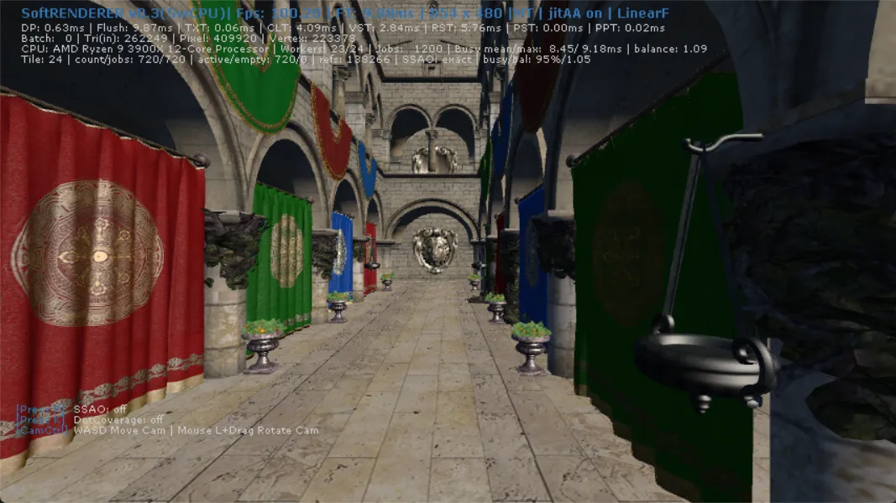

# SoftRenderer

An experimental software renderer for learning and research.

## Environment

SoftRenderer is a Windows x64/MSVC project. The following components are
required:

- Visual Studio with the Desktop development with C++ workload
- CMake 3.20 or newer
- The DirectX SDK files included under `code/thirdparty/dxsdk/`

## Quick start

Run `buildrun.bat` from the repository root, or double-click it in Explorer:

```bat
buildrun.bat
```

The script automatically selects the newest Visual Studio generator available
to CMake, configures an x64 Release build in `out/cmake-x64`, builds
SoftRenderer, and launches `bin/SoftRenderer.exe`.

To build without launching the application:

```bat
buildrun.bat --build-only
```

## Manual CMake build

For a Visual Studio generator available on your machine, configure and build
the x64 Release target with:

```powershell
cmake -S . -B out/cmake-x64 -G "Visual Studio 18 2026" -A x64
cmake --build out/cmake-x64 --config Release --target SoftRenderer
```

If your installed Visual Studio version is different, replace the generator
name accordingly. Run the application with `bin` as the working directory:

```powershell
Push-Location bin
& .\SoftRenderer.exe
Pop-Location
```

## Output layout

Build outputs are written directly to the repository's `bin/` directory:

```text
bin/
├── SoftRenderer.exe
├── renderer/SrSwRendererCpu.dll
├── shader/BasicShaders.swsl
├── shader/AdvanceShaders.swsl
└── media/                  # tracked runtime assets
```

The build does not copy runtime assets. The application uses the existing
tracked `bin/media/` directory.

## Optimization comparison

The following screenshots show the Sponza scene before and after the renderer
optimization. The optimized view includes the tile-binning statistics together
with the CPU model and worker information.

| Before | After |
| --- | --- |
|  |  |

## Tests

Build and run the deterministic tile layout/binning tests with:

```powershell
cmake --build out/cmake-x64 --config Release --target SoftRendererTests
ctest --test-dir out/cmake-x64 -C Release --output-on-failure
```

## Renderer options

The legacy backend remains available as an A/B reference. Use `--tile` for the
tile-binning renderer and `--legacy` for the legacy renderer. The default tile
size is 24×24 and can be overridden at runtime.

```text
--tile | --legacy
--workers=N
--tile-size=N
--width=N --height=N
--scene=sponza|model
--headless --frames=N
--no-jitaa --no-ssao --no-ui --relaxed-ssao
--hash-output=results.csv
```

`--relaxed-ssao` removes the global barrier between rasterization and full
G-buffer SSAO shading. It is memory-safe but schedule-dependent and may differ
visually from the exact default mode.

`--hash-output` writes per-frame color, depth, G-buffer, and winner hashes,
stage timings, tile/bin counts, worker statistics, and load-balance metrics.
Tile size and worker count can also be set with `SR_TILE_SIZE` and
`SR_WORKER_COUNT`.
