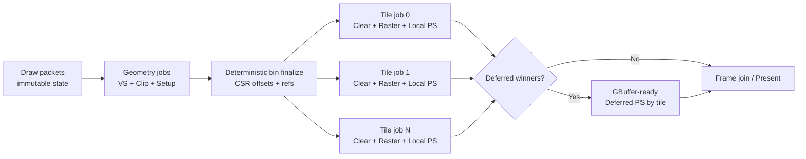

# SoftRenderer Tile Binning 并行渲染设计与开发计划

> 状态：已实现并通过性能 Gate（2026-07-18）  
> 基线提交：`dbc6527`（`dev`）  
> 编写日期：2026-07-17  
> 适用模块：`code/SrSwRendererCpu`、`code/SoftRenderer`、内置软件 Shader

## 实现摘要

本计划已落地为显式开启、可回退的 TileBinning 后端：draw-local geometry job
完成 VS/clip/setup，prepared triangle 通过确定性的两遍 CSR binner 分发到动态
tile batch；每个 tile 单 owner 完成 clear、raster 和 Local PS，`default_normal`
继续通过一次 GBuffer-ready deferred tile batch 保持 SSAO 语义。`--legacy` 可切回
旧流水线。性能 Gate 验证期间默认仍使用 Legacy，`--tile` 显式启用新后端；
`--workers`、`--tile-size`、headless/fixed-frame/hash CSV 已加入自动化入口。

2026-07-18 的 Release/854×480/24-thread 验证结果：默认 24×24 tile 的 Sponza
SSAO-on median/p95 相对 Legacy 分别改善 24.7%/26.2%，tile-stage busy ratio 88.3%，
worker busy `max/mean=1.12`；SSAO-off 改善约 34%，小 Model 改善约 5.6%。
批调度已移除每轮包装 task 分配，prepared/bin/count/start/deferred-winner 存储帧间复用，
并行 BinCount 同时完成 bbox，deferred shading 只遍历 winner 地址且与 temporal post 融合。

SSAO 目前保留为 Full-GBuffer 兼容 pass，没有改写材质输出公式；这是为了保持当前
`default_normal` 的图像语义。后端接口已把这条依赖显式化，后续可以在独立图像基线
下把 AO 算法迁移成单独 screen-space shader，而不再改动 tile ownership/binner。

另提供显式实验选项 `--relaxed-ssao`：tile 在 raster 完成后以 release store 发布
GBuffer，随后在同一个 job 内执行 deferred SSAO 和 temporal post；SSAO 对尚未以
acquire load 观察到 ready 的邻 tile 跳过采样。因此该模式没有 Raster→Deferred
全局 barrier，并保持内存安全，但颜色结果允许随 tile 调度变化；默认 exact 路径不变。
Release/854×480/24-thread/24×24 tile 的 180 帧验证中，默认 JitAA median/p95 从
20.57/22.18 ms 降至 19.82/21.22 ms，batch 从 5 降至 4，tile jobs 从 1440 降至
720，tile busy ratio 从 87.2% 提升至 92.8%。

提交与 UI 路径也完成了单线程算法收敛：`SrRendPrimitve`/帧 VB 描述符跨帧复用，
避免每个 subset 每帧重复分配和释放（顶点数据语义保持原样）；文本在启动时构建两套
ASCII glyph bitmap cache，帧内直接写入已锁定的 backbuffer，不再调用 D3D
`GetDC/ReleaseDC/DrawText`。`--headless` 自动跳过 UI，`--no-ui` 可用于交互 A/B。

## 1. 结论先行

建议将当前按 VS、Raster、PS 阶段分批派发的流水线，改造成 **sort-middle / tile-based backend**：

1. 几何前端只执行一次 VS、裁剪、三角形 setup，并把屏幕空间三角形引用放入 tile bin。
2. 屏幕划分为大量 tile；任意时刻一个 tile 只有一个 worker owner，但 tile 不固定绑定某个 CPU 核。
3. 每个 tile task 在自己的半开矩形内依次完成 clear、全部三角形的 raster/depth resolve、局部 PS 和可融合的逐像素后处理。
4. worker 动态领取 tile，避免中心重 tile 和空 tile 静态绑核造成尾部等待。
5. 普通局部 Shader 的主路径只保留一次“几何/bin 已就绪”的依赖和帧末 join，不再保留独立 Raster→PS 全局屏障。
6. 会读取其他屏幕像素 GBuffer 的 Shader 保留一次 GBuffer-ready 依赖；当前 `default_normal` 的 SSAO 就属于这一类。长期应把 SSAO 拆成显式 screen-space pass。

这里有一个必须澄清的边界：**不建议让每个 tile 从原始 VS 开始重复跑完整场景**。精确的 tile 归属只有在 VS、裁剪、透视除法和屏幕映射后才知道；字面意义的“每 tile 从 VS 跑到 PS”会让跨 tile 几何重复执行 VS/setup，成本可能随 tile 数放大。推荐方案仍能得到最重要的收益：tile 独占写入、缓存局部性、无像素锁、无全屏有效像素收集，以及局部 Shader 下 Raster/PS 无全局屏障。

首版目标流水线：

```text
Draw 提交/状态快照
        |
        v
Geometry jobs: VS -> Clip -> Patch/Project/Setup -> Bin count
        |
        |  唯一必要的前端就绪点 + 确定性 bin finalize
        v
Dynamic tile jobs: Clear tile -> Raster/depth -> Local PS -> Local post
        |
        +------ 若存在 ReadsFullGBuffer winner ------+
        |                                             v
        |                                  Deferred PS tile jobs
        v                                             |
Frame join <------------------------------------------+
        |
        v
Present
```

## 2. 目标与非目标

### 2.1 目标

- 提高多核利用率，减少阶段末尾快线程等待最慢任务的时间。
- 将核心渲染阶段的全池唤醒/等待从最多五轮，降为局部 Shader 下的前端就绪点与帧末 join。
- 让每个屏幕像素只有一个 tile owner，消除 Raster 热路径的共享写竞争。
- 删除 Raster 后主线程对整张 `zBuffer` 的有效像素扫描。
- 减少每 64 个 vertex/pixel 一次的 task `new/delete` 和全局任务栈锁竞争。
- 保持现有 opaque/deferred-winner 语义、Shader 调用方式、JitAA/DotCoverage 的帧序列行为。
- 建立可自动执行的图像回归和 benchmark，使后续优化有可比较基线。
- 保留 Legacy 路径作为开发期 A/B 和回退开关，直到正确性与性能门槛全部通过。

### 2.2 首版非目标

- 不在 tile 改造中顺带实现真正的 alpha blending、完整 alpha discard 或透明排序。
- 不把当前 scanline rasterizer 同时重写成 edge-equation/SIMD rasterizer；两项优化应分开评估。
- 不在首版解决任意自定义 viewport、Resize、MSAA 或多 render target。
- 不保证与当前存在数据竞争的 Legacy-MT 在共面/equal-depth 像素上逐位一致；先定义确定性 reference 语义。
- 不在首版实现 geometry/tile 的细粒度跨阶段流水重叠。若最终 profiling 证明前端就绪点仍是主要空闲来源，再引入有序 epoch task graph，见第 13 节。

## 3. 当前实现分析

### 3.1 帧调用链

当前一帧的主要调用链如下：

1. `SoftRenderApp::Update()` 调用 `BeginFrame()`、场景更新和 `EndFrame()`：[`SoftRenderApp.cpp:218`](../code/SoftRenderer/SoftRenderApp.cpp#L218)。
2. Scene/Entity/Mesh 逐 primitive 设置 shader、texture、constant 后调用 `DrawPrimitive()`：[`SrMesh.cpp:24`](../code/SoftRenderer/SrMesh.cpp#L24)。
3. `SrRasterizer::DrawPrimitive()` 为 draw call 创建 `SrRendPrimitve`，复制原始顶点到帧内 normalized VB，并快照 shader/context：[`SrRasterizer.cpp:64`](../code/SrSwRendererCpu/SrRasterizer.cpp#L64)。
4. `EndFrame()` 锁定 D3D backbuffer，然后调用 `SrRasterizer::Flush()`：[`SrSoftRenderer.cpp:161`](../code/SrSwRendererCpu/SrSoftRenderer.cpp#L161)。
5. `Flush()` 才真正执行 clear、VS、Raster、PS、JitAA，最后释放帧内 primitive：[`SrRasterizer.cpp:138`](../code/SrSwRendererCpu/SrRasterizer.cpp#L138)。

`DrawPrimitive()` 已经把矩阵、纹理、光源列表和 shader constants 复制到 draw-call context（`SrRasterizer.cpp:109-116`），这正适合继续演化成不可变 `DrawPacket`。所有并行任务只读 packet，帧末 join 后统一回收。

### 3.2 当前任务系统

`SrRasTaskDispatcher` 创建 `processorNum - 1` 个后台线程，主线程在 `FlushCoop()` 中也参与取任务：[`SrRasTaskDispatcher.cpp:87`](../code/SrSwRendererCpu/SrRasTaskDispatcher.cpp#L87)、[`SrRasTaskDispatcher.cpp:127`](../code/SrSwRendererCpu/SrRasTaskDispatcher.cpp#L127)。

任务粒度是固定宏：

| 阶段 | 粒度 | 定义/提交位置 |
|---|---:|---|
| VS | 64 vertices | `prerequisite.h:81`、`SrRasterizer.cpp:216-224` |
| Raster | 512 triangles | `prerequisite.h:83`、`SrRasterizer.cpp:278-286` |
| PS | 64 pixels | `prerequisite.h:82`、`SrRasterizer.cpp:384-392` |

每个 task 都单独分配；所有 worker 从同一个 LIFO `std::stack` 取任务，每次取任务都进入全局 `g_taskCS`：[`SrRasTaskDispatcher.cpp:67`](../code/SrSwRendererCpu/SrRasTaskDispatcher.cpp#L67)。每次 `Wait()` 后再逐个 `delete` 当前批次 task：`SrRasTaskDispatcher.cpp:188-194`。

这套模型在任务短小、核心数较多时，会同时承受：

- task 堆分配/回收；
- 单一临界区争用；
- 每个阶段唤醒全部 worker；
- 每个阶段等待最慢任务；
- LIFO 和多线程造成的不稳定执行顺序。

### 3.3 当前同步点

用户观察到的 VS、Raster、PS 三个主同步点确实存在，但默认路径实际最多有五次全池 `FlushCoop()/Wait()`：

| 批次 | 提交范围 | 全局等待 | 备注 |
|---|---|---|---|
| Clear | `SrRasterizer.cpp:165-185` | `188-189` | color/z 清理 |
| VS | `211-225` | `245-247` | transformed VB 完整后 Raster 才能读取 |
| Raster | `265-330` | `358-360` | 全屏 GBuffer/z 完整后才能收集 pixel |
| PS | `371-393` | `395-397` | Raster 后先由主线程全屏扫描 zBuffer |
| JitAA/DotCoverage | `443-451` | `453-454` | 开启功能时存在 |

默认 Sponza 同时开启 MT、JitAA、Linear Filtering：[`SrSponzaApp.cpp:18`](../code/SoftRenderer/SrSponzaApp.cpp#L18)，所以默认运行会命中五轮等待。

### 3.4 串行工作与共享写

Raster 完成后，主线程逐像素扫描整张 `zBuffer`，把 `z < 0` 的地址写入 `m_fBufferIndices`，再生成 PS task：[`SrRasterizer.cpp:371`](../code/SrSwRendererCpu/SrRasterizer.cpp#L371)。这段工作既串行，又会读取整张屏幕，即使有效像素很少也不能跳过。

Raster task 按三角形块拆分，不按屏幕区域拆分，所以多个 worker 可能同时覆盖同一像素。`RASTERIZER_SYNC` 默认关闭：[`prerequisite.h:19`](../code/SoftRenderer/prerequisite.h#L19)。无锁路径会并发读写 `zBuffer[address]`、`SrFragment` 和其 primitive 指针：[`SrRasterizer_Algo.cpp:735`](../code/SrSwRendererCpu/SrRasterizer_Algo.cpp#L735)。

即使启用 `RASTERIZER_SYNC`，当前锁也只包住 depth compare/update，释放锁后才写 fragment；仍可能出现最终 depth winner 与 GBuffer winner 不一致。与此同时，`SrFragmentBuffer` 无论宏是否启用都会为每个像素构造一个 `CRITICAL_SECTION`：[`SrFragmentBuffer.cpp:7`](../code/SrSwRendererCpu/SrFragmentBuffer.cpp#L7)。tile 单 owner 可以从结构上消除这类竞争和锁数组。

### 3.5 当前基线中的已知正确性问题

这些问题应先独立修复或明确冻结语义，否则无法建立可靠 golden：

- Legacy-ST 和 Legacy-MT 的 clear 不一致。MT 清 color/z，ST 清 color/fragment、没有清 z；`zBuffer` 构造时也未初始化：`SrRasterizer.cpp:165-200`、`SrFragmentBuffer.cpp:7-20`。
- equal-depth 只拒绝 `z > oldZ`，相等会覆盖；LIFO + 多线程使最终 winner 不确定：`SrRasterizer_Algo.cpp:763-767`。
- `SrProfiler::setIncrement()` 是普通 `count +=`，多个 Raster worker 会同时更新 triangle count：`SrProfiler.cpp:45-48`、`SrRasterizer_Algo.cpp:48`。
- worker 数按逻辑处理器数创建，但 profiler 只预留 Thread0～Thread15；超过 17 个逻辑处理器时存在索引越界：`SrRasTaskDispatcher.cpp:87-100`、`SrProfiler.h:41-57`、`SrRasTaskDispatcher.cpp:44`。
- `WaitForMultipleObjects` 一次等待全部 worker handle，受 64 handle 限制；单逻辑处理器时还会得到空 handle 数组：`SrRasTaskDispatcher.cpp:174-185`。
- D3D lock 返回真实 `Pitch` 并保存到 `m_bufferPitch`，但 PS 仍按紧密的 `outBuffer + linearAddress` 写入：`SrSoftRenderer.cpp:163-175`、`SrRasTasks.cpp:20-31`。

## 4. 为什么不直接让每个 Tile 重跑 VS

三角形属于哪些 tile，需要依次知道：

1. VS 输出的 clip-space position；
2. 视锥拒绝和近裁剪结果，裁剪可能把一个三角形变成两个：[`SrRasterize_Clip.cpp:17`](../code/SrSwRendererCpu/SrRasterize_Clip.cpp#L17)；
3. `ProcessPatch()` 和背面剔除结果：`SrRasterizer_Algo.cpp:21-53`；
4. 透视除法、varying 的 `1/w` 处理和屏幕映射结果：`SrRasterizer_Algo.cpp:55-75`；
5. 屏幕空间保守包围盒。

因此可选方案实际是：

| 方案 | VS 次数 | 同步 | 代价/结论 |
|---|---:|---:|---|
| 每 tile 遍历全场景并运行 VS | 最坏接近 tile 数倍 | 最少 | 几何计算和遍历放大，不采用 |
| 全局 VS 后 bin，tile 后端 Raster+PS | 每 vertex 一次 | 一次前端就绪 | 首版最稳妥，采用 |
| Geometry job 融合 VS/clip/setup/bin，再 tile 后端 | 每 vertex 一次或 chunk 内少量重复 | 一次 bin 封口 | 目标实现，采用 |
| 有序 geometry epoch + 每 tile 依赖链 | 每 vertex 一次 | 无整帧前端屏障，但有局部依赖 | 后续实验，不作为首版 |

GPU 语境下的 binning 也不是让每个 tile 独立重跑全部顶点，而是几何前端先产生屏幕空间 primitive，再把 primitive reference 分发给 tile 后端。本方案沿用这个分工。

## 5. 目标架构

### 5.1 逻辑阶段



### 5.2 两条像素路径

#### Local 快路径

满足以下条件的 Shader 可在 tile 内直接着色：

- PS 只读当前 `SrFragment`、draw packet、texture/light/constant；
- 不读其他屏幕位置的 GBuffer；
- 不读/混合目标 color；
- 当前 opaque 语义下只需为最终 depth winner 执行一次 PS。

tile task 先 raster 完该 bin 的所有三角形，再遍历 tile 内 `z < 0` 的最终 winner 执行 PS。不能在每个三角形 Raster 后立刻 PS，否则会重新引入 overdraw，并改变当前“只 shade 最终 winner”的语义。

#### Full-GBuffer 兼容路径

`SrPhongWithNormalShader::ProcessPixel()` 会为 SSAO 读取其他屏幕位置的 `fBuffer->GetWorldPos()`：[`BasicShaders.cpp:516`](../code/BasicShaders/BasicShaders.cpp#L516)，关键读取在 `BasicShaders.cpp:568-591`。默认 Sponza 初始化时会切换到这个 `default_normal` Shader：`SrSponzaApp.cpp:258-275`。

因此该 winner 的 PS 必须等所有 tile 的 GBuffer Raster 完成。首版处理方式：

1. tile Raster 时仍完成本 tile 的 depth/GBuffer；
2. Local winner 可直接 shade；
3. Full-GBuffer winner 只记录到该 tile 的 deferred mask/list；
4. 所有 tile Raster 完成后，按 tile 并行执行 deferred PS；
5. 若一个 frame 没有 deferred winner，则完全跳过该 barrier/batch。

长期将 SSAO 从材质 PS 拆成显式 screen-space pass。这样 `default_normal` 的基础纹理/光照可走 Local 快路径，只有 AO pass 需要 GBuffer-ready 依赖。

## 6. 帧内数据模型

以下为建议接口，命名可在实现时微调，但所有权和顺序语义不应改变。

```cpp
enum SrPixelDependencyFlags
{
    ePd_LocalPixel          = 0,
    ePd_ReadsFullGBuffer    = 1 << 0,
    ePd_ReadsDestination    = 1 << 1,
};

struct SrDrawPacket
{
    uint32 drawSequence;
    const SrVertexBuffer* sourceVB;
    const SrIndexBuffer* indexBuffer;
    const SrSwShader* shader;
    SrShaderContext shaderContext;
    uint32 pixelDependencyFlags;
};

struct SrPreparedTriangle
{
    SrRendVertex vertices[3];       // clip/patch/透视除法/屏幕映射完成
    const SrDrawPacket* draw;
    uint32 sourceTriangleSequence;
    uint8 clippedSubTriangleSequence;
    SrRectI pixelBounds;            // 保守、已 clamp 的半开范围
};

struct SrTileDesc
{
    SrRectI rect;                    // [x0, x1) x [y0, y1)
    uint32 refBegin;
    uint32 refEnd;
    uint32 estimatedCost;
};

struct SrTileBins
{
    std::vector<uint32> tileOffsets; // tileCount + 1
    std::vector<uint32> triangleRefs;
};

struct SrColorBufferView
{
    uint8* base;
    uint32 width;
    uint32 height;
    uint32 pitchBytes;
};

struct SrTileScratch
{
    // 大小按最大 tile 预分配，每个 worker 一份，帧间复用
    uint32 activeMaskWords[kMaxTilePixels / 32];
    uint32 deferredMaskWords[kMaxTilePixels / 32];
    SrWorkerStats* stats;
};
```

### 6.1 顺序

每个 prepared triangle 的稳定顺序键为：

```text
(drawSequence, sourceTriangleSequence, clippedSubTriangleSequence)
```

每个 tile bin 必须按该顺序升序。深度相等时后提交者覆盖前提交者，与 `z > oldZ` 才拒绝的既有规则一致，同时把当前不确定的 task 完成顺序改为确定行为。

不要让多个 Geometry worker 无序地直接 `push_back()` 到同一个 tile vector；即使加锁保证内存安全，也会破坏顺序确定性。

### 6.2 生命周期

- `DrawPacket`、prepared triangle、bin refs、tile state 全部属于 `SrFrameContext`。
- Frame arena 在 `BeginFrame/Flush` 前重置，在最后一个 tile/deferred/post task join 后才能回收。
- texture、IB、shader、light 和 packet 引用在 join 前必须保持有效。
- 当前 primitive 在 `Flush()` 尾部统一删除（`SrRasterizer.cpp:466-473`），可以作为首版生命周期边界；异步跨帧前不得提前释放。

### 6.3 Shader 能力元数据

建议扩展 `SrSwShader`，由内置 Shader 显式声明 pixel dependency：

| Shader | 首版分类 | 依据 |
|---|---|---|
| flat / gourand / default | Local | 只读当前 fragment、texture、light |
| skin / fresnel / hair | Local | 当前实现无跨屏读取 |
| default_normal | ReadsFullGBuffer | PS 内嵌 SSAO 邻域采样 |
| 未声明/外部旧 Shader | 保守兼容 | 默认按 ReadsFullGBuffer 或 Legacy 处理 |

Shader 以 DLL 动态加载（`SrSoftRenderer.cpp:354-401`）。改变 `SrSwShader` 布局或 vtable 后必须全量重建 renderer/shader DLL；若需要兼容外部模块，应同时加入简单的 Shader ABI version 检查，避免混用旧 `.swsl`。

## 7. Geometry、Setup 与 Binning

### 7.1 先拆开“准备三角形”和“写像素”

当前 `RasterizeTriangle_Clip()` 和 `RasterizeTriangle()` 都是 `void`，会直接继续 Raster 并写全局 buffer：[`SrRasterizer.h:123`](../code/SrSwRendererCpu/SrRasterizer.h#L123)。必须拆成：

1. `ClipTriangle(...) -> 0..N SrRastTriangle`；
2. `SetupTriangle(...) -> optional SrPreparedTriangle`；
3. `ComputeConservativeBounds(...)`；
4. `BinTriangle(...)`；
5. `RasterizePreparedTriangle(prepared, tileContext)`。

建议先用一个覆盖全屏的 tile 跑通新接口，确认单线程输出，再启用 grid 和并行。这样能把算法重构错误与并发错误分开。

### 7.2 VS 与 Geometry job 粒度

不要在第一步同时解决“VS 跨三角形复用”和“前后端完全流水化”。建议分两级演进：

**兼容实现**继续使用现有 transformed VB：

1. VS 按 vertex range 并行写各自不重叠的 transformed VB；
2. VS batch 完成后，setup/bin jobs 只读 transformed VB；
3. bin 封口后执行 tile backend。

它仍保留 VS→Setup 的前端内部等待，但已经能删除 Raster→PS 等更重的后端屏障，并建立正确的 tile ownership。Phase 1～3 优先采用这一形态。

**目标实现**以 draw packet 为基本 Geometry job：

1. 一个 job 独占该 draw 的 transformed VB；
2. 在 job 内执行该 draw 的全部 VS；
3. 紧接着装配 triangle、clip/setup，并写 job-local prepared/bin count；
4. 多个 draw packet 并行执行，不再需要整帧 VS batch barrier。

如果单个 draw 很大，不能简单把 triangle 分给多个 job 后让每个 job 无限制重复三个顶点的 VS。应按 profiling 选择：

- 给该 draw 建立局部依赖：多个 VS chunks 完成后再释放该 draw 的 setup chunks；或
- 使用 chunk-local 小型 transformed-vertex cache，只允许有统计上限的重复 VS；或
- 在 task graph 完成前，让超大 draw 暂时保留两阶段路径。

无论采用哪种方式，同一个 indexed vertex 的正常目标都是每 draw 只执行一次 VS；任何为减少 barrier 而引入的重复次数都必须计入 stats，并设置放大率 Gate。

### 7.3 首版 Binner

首版先实现确定性串行 binner：按稳定 triangle sequence 遍历 prepared triangles，计算 tile 范围并依次 append 引用。它不是最终性能形态，但便于验证：

- tile 边界无漏 bin；
- clipped subtriangle 顺序稳定；
- full-screen/超大三角形的引用数可统计；
- bin arena overflow 能显式 fallback，而不是越界。

### 7.4 目标并行 Binner

稳定后改为两遍 CSR（compressed sparse row）布局：

1. 输入按稳定 sequence 切成连续 geometry chunks。
2. 每个 worker/chunk 产生本地 prepared triangles 和 `tileCounts[]`，不共享 append。
3. 主线程或短 parallel reduction 计算每 tile 总数和 `tileOffsets`。
4. 根据“更早 chunk 在前”的规则计算每个 chunk 对每个 tile 的 scatter 起点。
5. 各 chunk 并行写自己唯一的 `triangleRefs` 范围，天然保持 bin 内稳定顺序。

最终 bin 使用扁平数组：

```text
tileOffsets:  [0, 3, 3, 8, ...]
triangleRefs: [t0, t1, t2,  t4, t8, t9, t10, t11, ...]
```

三角形顶点只在 prepared arena 存一份。跨多个 tile 时仅复制 32 位引用，避免复制三个完整 `SrRendVertex`。

### 7.5 巨型三角形

保守 bbox 会把大三角形放入 bbox 覆盖的所有 tile，即使三角形实际没有覆盖某些角落。首版允许 false positive，但绝不允许 false negative。收集 `binReferences / preparedTriangles` 放大率；若大三角形使 bin 内存或空 Raster 明显上升，再加入：

- triangle-vs-tile conservative overlap test；或
- large-primitive 单独列表，由 tile task 额外遍历。

不要在没有数据前提前增加复杂分支。

## 8. Tile Raster 与像素处理

### 8.1 Tile 边界

tile 必须使用严格半开区间：

```text
[x0, x1) × [y0, y1)
```

右侧和底部最后一个 tile 可以小于配置尺寸。每个 framebuffer 像素必须恰好属于一个 tile。

跨 tile 三角形会出现在多个 bin，但每个 tile 只能写自己的矩形。不要把三角形几何重新裁到 tile 边缘；应保留原始屏幕三角形和插值端点，只在整数像素覆盖范围生成后应用 tile scissor。否则 tile 两侧可能因不同插值端点产生裂缝或属性不连续。

bin bbox 必须先扩成保守的整数半开范围，再 clamp 到 viewport/render target。首版可按 `floor(min)` / `ceil(max)` 并额外向外扩一像素，以覆盖当前 scanline 的 `int(fend) + 1` 行为；允许多 bin 一个 tile，不能漏掉实际覆盖 tile。只有在 seam/coverage 单测锁定精确规则后，才收紧这一个像素的保守边界。

当前 `_Clipped` scanline 已经使用原 `fstart/fend` 计算 ratio，再从 `clipStart` 调整起始 ratio：`SrRasterizer_Algo.cpp:260-319`。重构时应把“覆盖整数化”和“最终 scissor”明确拆开，并统一 clipped/unclipped 的 inclusive/exclusive 规则。

### 8.2 Tile task 步骤

每个 Local tile task 执行：

1. 取得唯一 tile owner 权；
2. clear 该 tile color、z、active/deferred mask；
3. 如本帧存在 Full-GBuffer reader，确定性清零该 tile 的 fragment 背景；
4. 按 bin 稳定顺序 Raster 所有 prepared triangles；
5. depth 通过时写 `zBuffer`、完整 `SrFragment` 和 active bit；
6. 遍历 active bit，并继续保留当前 `z < 0` 有效条件；
7. Local winner 立即调用 PS；Full-GBuffer winner 设置 deferred bit；
8. 若该 tile 没有 deferred pixel，可执行逐像素 JitAA/DotCoverage；
9. 提交 tile stats，释放 owner。

active bitset 用来避免全屏收集，但不能单独改变有效像素定义。当前 PS 只处理 `z < 0`；深度恰为 `0` 的 touched pixel 仍不应被着色。

### 8.3 Buffer 布局与 Pitch

首版保留全屏 AoS `SrFragment[]` 和独立 `float zBuffer[]`，只改变访问所有权。这能兼容 `GetWorldPos()`，也能减少改造范围。

color 写入必须使用：

```cpp
uint32* color = reinterpret_cast<uint32*>(
    colorView.base + y * colorView.pitchBytes + x * sizeof(uint32));
```

传给 Shader 的 `address` 仍是逻辑地址 `y * width + x`，因为 SSAO、JitAA、DotCoverage 的棋盘/采样逻辑依赖它。

### 8.4 Clear 语义

Phase 0 必须先明确并冻结：

- color clear = `SR_GREYSCALE_CLEARCOLOR`；
- z clear = `0.0f`；
- active/deferred mask = 0；
- Full-GBuffer reader 存在时，背景 fragment 每帧清零，禁止 SSAO 读到上一帧 stale GBuffer；
- Local-only frame 可不清 fragment，因为只有 active winner 会被读取。

这是对当前 ST/MT 不一致的显式正确性修复，应独立提交并更新 golden，不能隐藏在性能改动里。

### 8.5 深度与顺序

首版保留当前深度定义：

- clear 为 `0`；
- 插值后执行 `z -= 1`；
- `z > oldZ` reject；
- equal-depth 时 sequence 更晚者覆盖。

tile 单 owner 后，depth compare、depth write、fragment write 是同一线程中的连续操作，可删除热路径的 per-pixel critical section，也不会再出现 depth/GBuffer winner 不一致。

### 8.6 Alpha 与透明

当前 `m_alphaBlend` 只声明/初始化，没有消费；alpha-test 分支中的实际 texture alpha reject 也已注释：`SrMaterial.h:45-46`、`SrRasterizer_Algo.cpp:782-825`。因此首版只承诺当前 opaque/deferred-winner 语义。

未来透明 pass 需要：

- 按稳定提交顺序执行 per-fragment PS/blend；或
- 独立收集并排序透明 fragment。

它不能复用“每像素只保留一个最终 GBuffer winner”的路径。

## 9. Shader 与后处理兼容矩阵

| 功能 | 首版策略 | 是否额外 barrier |
|---|---|---:|
| 普通 Local Shader | tile 内 Raster 后直接 PS | 否 |
| `default_normal` 内嵌 SSAO | deferred PS by tile | 是，GBuffer-ready |
| JitAA | Local-only tile 尾部融合；有 deferred 时延后 | 视 deferred 而定 |
| DotCoverage | 保留 logical address/frameCount 规则，按 tile 执行 | 视 deferred 而定 |
| Interlace | scanline 内保留现有 frame parity 判断 | 否 |
| RHZ primitive | 先纳入同一 prepared/bin 结构；未完成前走 Legacy | 取决于实现 |
| helper line | 当前 Raster 路径本就注释/FIXME；首版不扩展 | 无 |
| destination read / blending | 保守走 Legacy，另立透明 pass | 不适用 |
| 非全屏 viewport / Resize | 保持现有默认行为，单独开发 | 不适用 |

当前 JitAA 每个像素只读取当前帧和上一帧同地址 color：[`SrRasTasks.cpp:67`](../code/SrSwRendererCpu/SrRasTasks.cpp#L67)，因此没有邻 tile 数据依赖。所有像素完成后可交换 `m_MemSBuffer/m_BackSBuffer` 的角色，替代当前整屏 `memcpy`（`SrRasterizer.cpp:456`）；需先确认 render texture 生命周期和展示目标不依赖固定对象身份。

## 10. 调度器设计

### 10.1 所有权不等于固定绑核

“一个 tile 交给一个核心”应解释为：**一个 tile task 执行期间只有一个 worker 写该 tile**，而不是 tile `(x,y)` 永久绑定 CPU `n`。

固定绑定会导致：

- 空白 tile 很快结束；
- 屏幕中心或高 overdraw tile 很慢；
- 快核心不能接手重 tile；
- 帧尾仍等待最慢固定分区。

建议 tile 数显著多于 worker 数，worker 动态领取下一 tile。854×480 在 32×32 下约 405 个 tile，足够平衡常见核心数。

### 10.2 首版批调度 API

将“每项一个多态堆 task”替换为无分配 batch/parallel-for：

```cpp
RunBatch(jobCount, frameContext, ExecuteJob);
```

- job 描述存于连续数组；
- worker 通过 `std::atomic<uint32> nextJob` 领取索引；
- 主线程也参与；
- worker 每批只唤醒一次；
- 完成使用 countdown + event/condition variable，不一次等待 N 个 worker handle；
- worker 有永久的 scratch 和 cache-line-padded stats；
- shutdown 使用 stop flag + join，不使用强制终止线程。

tile job 足够重时，单个原子 cursor 的开销通常可接受。若 profiling 显示 cursor 争用，再升级为 per-worker deque/work stealing，而不是先做复杂调度器。

### 10.3 负载估算

tile 可按下列近似成本从高到低排序，再由原子 cursor 领取：

```text
estimatedCost = binRefCount * setupCostWeight + conservativePixelArea
```

排序只改变 tile 领取次序，不得改变 tile bin 内 triangle sequence。优先处理重 tile 可以减少帧尾长尾。

### 10.4 统计

不要从 worker 直接写当前共享 `SrProfilerElement`。新增 `SrFrameStats` 和每 worker 独立、cache-line 对齐的 `SrWorkerStats`，帧末主线程归并。

至少记录：

- geometry/setup/bin/tile-raster/local-PS/deferred-PS/post 时间；
- 每个 barrier/wait 时间；
- input/clipped/culled/prepared triangle 数；
- bin ref 数、放大率、arena 高水位；
- active/empty/deferred tile 和 shaded pixel 数；
- 每 worker busy/idle、tile 数、最大 task 时间；
- 每 tile bin refs、covered pixels、task time 分布；
- 帧内堆分配次数。

## 11. Tile 尺寸与内存

当前 `SrFragment` 包含四个 `float4` 和一个 primitive 指针（`prerequisite.h:359-374`）。按当前 Win32 对齐布局估算：

| Tile | Fragment 工作集 | 特点 |
|---|---:|---|
| 16×16 | 约 20 KiB，另加 depth/color/mask | 更接近 L1，task/bin ref 更多 |
| 32×32 | 约 80 KiB，另加 depth/color/mask | 主要落入 L2，调度开销较低 |
| 64×64 | 约 320 KiB，另加其他 buffer | task 少、负载长尾和 cache 压力大 |

建议初始默认 32×32，但必须 benchmark 8/16/32/64 后决定。不要把 tile size 固化为编译宏；至少允许命令行或 renderer config 覆盖。

bin 内存估算：

```text
prepared memory + 4 bytes * binReferenceCount + 4 bytes * (tileCount + 1)
```

使用 frame arena/pool，并记录高水位。warm-up 后每帧 scheduler/binning 堆分配目标为 0。arena 不足时应打印一次明确错误并回退 Legacy，不能静默截断 triangle refs。

## 12. 分阶段开发计划

每个 Phase 建议独立 PR/提交组；必须通过退出条件后再进入下一 Phase。

### Phase 0：基线、语义、自动化与回退开关

工作项：

- 增加运行时 `LegacyStage` / `TileBinning` 开关，tile 默认关闭。
- 增加 worker 数、tile size、分辨率、固定帧数、场景和 feature bitmask 的命令行参数。
- 修复并统一 ST/MT clear；初始化 zBuffer；明确背景 fragment 语义。
- 把 worker profiler 改为动态 per-worker 数据，先保护高核数越界。
- 定义 stable submission sequence 和 equal-depth winner。
- 新增 headless/fixed-camera 模式，固定帧后退出，导出 color/depth/GBuffer hash 和 CSV/JSON stats。
- 在 CMake 增加 `SoftRendererTests`、`SoftRendererBench`、`enable_testing()`/CTest；当前仓库没有任何测试 target。
- Legacy 路径保持可用，用确定性单线程 reference 建 golden；Legacy-MT 只作为旧性能参考。

主要文件：

- `code/SoftRenderer/SoftRenderApp.*`
- `code/SoftRenderer/SrProfiler.*`
- `code/SoftRenderer/prerequisite.h`
- `code/SrSwRendererCpu/SrFragmentBuffer.*`
- `code/SrSwRendererCpu/SrRasterizer.cpp`
- `CMakeLists.txt`

退出条件：

- reference 模式连续运行 100 次 hash 一致；
- Debug/Release 测试可无人值守运行并退出；
- baseline CSV 包含完整帧时间和各阶段 wait；
- 1、2、4、8、逻辑核 worker 配置都不会越界或挂死。

### Phase 1：单 Tile 算法解耦

工作项：

- `RasterizeTriangle_Clip()` 改为输出 0..N clipped triangles，不直接写 framebuffer。
- 将 cull/patch/perspective/screen mapping 拆成 `SetupTriangle()`。
- Raster API 显式接收 `SrTileRect/SrTileContext`。
- 先使用一个覆盖全屏的 tile，单线程运行新路径。
- 统一 clipped/unclipped scanline 的半开边界和插值基准。
- 引入 pitch-aware color view。

主要文件：

- `code/SrSwRendererCpu/SrRasterizer.h`
- `code/SrSwRendererCpu/SrRasterize_Clip.cpp`
- `code/SrSwRendererCpu/SrRasterizer_Algo.cpp`
- 建议新增 `SrTileTypes.h`、`SrTriangleSetup.*`

退出条件：

- 合成场景 color/depth/GBuffer 与 reference 一致；
- near clip 产生 0/1/2 triangle 的测试通过；
- guard/canary 证明没有 tile/framebuffer 越界。

### Phase 2：Tile Grid、串行 Binning、兼容型 Tile Raster

工作项：

- 实现 `TileLayout` 和右/下残缺 tile。
- 实现 `SrPreparedTriangle` arena、stable sequence 和串行 bins。
- tile 单 owner，动态 tile queue。
- tile 内 clear + Raster；先在所有 tile Raster 后保留 GBuffer-ready barrier。
- PS 按 tile 扫描 active/depth，删除主线程全屏 pixel-index 收集。
- Legacy 与 Tile 对同一输入做 A/B 输出比较。

主要文件：

- `code/SrSwRendererCpu/SrRasterizer.*`
- `code/SrSwRendererCpu/SrRasTasks.*`
- `code/SrSwRendererCpu/SrRasTaskDispatcher.*`
- `code/SrSwRendererCpu/SrFragmentBuffer.*`
- 建议新增 `SrTileBinner.*`、`SrTileRasterizer.*`

退出条件：

- tile seam 测试零差异；
- 所有像素恰好一个 owner；
- 任意 worker 数、任意领取顺序下连续 100 次 hash 一致；
- 不再需要 Raster 热路径 pixel lock；
- 不再执行 `SrRasterizer.cpp:371-379` 的全屏有效像素扫描。

### Phase 3：Local Shader Raster+PS 融合

工作项：

- 给 Shader 增加 dependency metadata；未声明 Shader 保守回退。
- tile task Raster 完所有三角形后，直接 shade Local winners。
- Full-GBuffer winners 记录 deferred mask，GBuffer-ready 后按 tile shade。
- JitAA/DotCoverage 改为 tile 范围；Local-only frame 在 tile 尾部执行。
- 用 buffer 角色交换替代 JitAA 后整屏 copy（验证后启用）。

主要文件：

- `code/SoftRenderer/SrSwShader.h`
- `code/BasicShaders/BasicShaders.*`
- `code/AdvanceShaders/AdvanceShaders.*`
- `code/SrSwRendererCpu/SrTileRasterizer.*`
- `code/SrSwRendererCpu/SrRasterizer.cpp`

退出条件：

- Local-only frame 不再有独立 Raster→PS 全局等待；
- Full-GBuffer frame 明确只增加一次必要的 deferred barrier；
- default、default_normal、skin、fresnel、hair 图像回归通过；
- JitAA/DotCoverage/Interlace 的连续多帧 hash 通过。

### Phase 4：并行 Binning 与调度调优

工作项：

- 将串行 binner 替换为 per-chunk count + deterministic prefix/scatter。
- 在 draw 数量足以并行时融合 draw-local VS + clip/setup/bin；超大 draw 使用局部依赖，不无界重复 VS。
- frame arena 和 task 描述 warm-up 后零堆分配。
- tile 按估算成本优先领取；评估 atomic cursor 是否足够。
- 评估 8/16/32/64 tile、不同 worker 数和分辨率。
- 根据数据决定是否增加 precise triangle/tile overlap 或 large-triangle 路径。
- worker stats 和 queue metadata 做 cache-line 隔离，避免 false sharing。

退出条件：

- worker 数与领取顺序不影响输出；
- `executedVertexShaderCount / uniqueDrawVertexCount` 被记录；正常路径目标为 1.0，任何例外有明确上限；
- binning 时间、内存放大和负载均衡达到第 15 节门槛；
- 0 tile、1 tile、tile 少于/多于 worker、worker 多于 tile 均可正确退出。

### Phase 5：拆分 SSAO、默认启用与清理

工作项：

- 把 `default_normal` 的 SSAO 邻域读取拆成显式 screen-space pass。
- 基础材质 PS 走 Local 路径，SSAO 以 tile-parallel post pass 执行。
- 达标后默认启用 TileBinning；Legacy 至少保留一个发布周期。
- 删除 `SrFragmentBufferSync[]`、pixel-index buffer、旧 VS/Raster/PS 小 task 类型和废弃 dispatcher API。
- 更新 README、benchmark 说明和本设计文档的“已实现状态”。

退出条件：

- 默认 Sponza SSAO on/off 都通过回归和性能门槛；
- 10,000 帧 soak 无泄漏/arena 增长；
- Legacy 回退仍能一键启用；
- 文档、命令行帮助和 profiler overlay 与新术语一致。

## 13. 可选后续：有序 Epoch 流水

如果 Phase 4 数据显示 Geometry→Tile 前端就绪点仍造成显著 worker idle，可在不重复 VS 的前提下引入有序 epoch：

1. 按 draw/triangle sequence 把一帧分成若干 geometry epoch；
2. epoch `e` 的 geometry jobs 完成并封口自己的 bins 后，可发布 `TileRaster(tile,e)`；
3. 同一 tile 的 task 串成依赖链：`TileRaster(tile,e)` 依赖 `TileRaster(tile,e-1)`；
4. tile depth/GBuffer 跨 epoch 保留，只有最终 epoch 完成后才执行 winner PS；
5. 后续 epoch 的 Geometry 可与前面 epoch 的 Tile Raster 重叠。

这能把全局阶段 barrier 改成局部 dependency，但会显著增加 scheduler、生命周期和 bin 管理复杂度。必须满足以下前提才值得开发：

- 前端 wait 占 Flush 的比例已经被统计证明确实显著；
- Phase 0～4 的 deterministic tests 完整；
- task graph 支持多生产者安全发布和依赖计数；
- 每 tile 仍保持单 owner，epoch 不并发写同一 tile；
- sequence、clip output 和 deferred PS 语义不改变。

不要用“每 tile 重跑 VS”来替代这个 task graph。

## 14. 测试计划

### 14.1 单元测试

#### TileLayout

- 分辨率：1×1、31×17、32×32、33×33、854×480、1280×720、1920×1080；
- tile：8、16、32、64；
- 验证所有像素恰好属于一个 tile，无重叠、无空洞；
- 验证右/下残缺 tile 和非紧密 color pitch。

#### Clip / Setup / Binning

- tile 内单三角形；
- 跨水平/垂直 tile 边界；
- 恰好跨四 tile 角点；
- 屏幕外、部分屏幕外、near/far clip；
- near clip 输出两个 triangle；
- 退化、零面积、超大三角形；
- 大量微三角形；
- conservative bin 允许 false positive，但不得有 false negative；
- 每个 tile 的 sequence 严格稳定。

#### Raster / Depth

- tile 边界共享边，top-left 规则；
- 右/下残缺 tile；
- 前后遮挡、equal-depth 后提交者获胜；
- 一个三角形跨多个 tile 的 color/depth/GBuffer 精确一致；
- alpha-test 现有语义；
- tile rect 外 guard/canary 不得修改。

#### Scheduler

- 0/1/N tile；
- tile 少于、等于、多于 worker；
- 每 tile 恰好执行一次；
- 不同人工延迟模拟重/空 tile；
- worker pool 重复 init/shutdown；
- 失败/fallback 时能 join 并回收 frame arena。

### 14.2 图像集成测试

优先使用程序化小场景：

- 空场景、单三角形、全屏三角形；
- 互相遮挡和共面不同材质三角形；
- 跨 seam 的细长三角形；
- near-plane clip；
- 几何全部集中在单 tile 的极端负载；
- default/default_normal/skin/fresnel/hair；
- JitAA、DotCoverage、Interlace 的连续 N 帧序列。

资产场景：

- ModelViewer 小模型；
- Sponza SSAO off（Local 快路径上限）；
- 默认 Sponza SSAO on（真实兼容路径，必须单独报告）。

比较标准：

- 合成测试 color byte、depth bit pattern、GBuffer 精确一致；
- tile seam 测试不允许容差；
- Sponza 优先完全一致；若 `/fp:fast` 经验证产生不可避免差异，可使用“不同像素 ≤ 0.01%、每通道最大差 1、SSIM ≥ 0.9999”；
- temporal feature 比较完整帧 hash 序列，不只比较单帧；
- 每个 worker/tile 配置重复 100 次，hash 必须一致。

### 14.3 内存与稳定性

- Debug CRT leak check；条件允许时增加 MSVC AddressSanitizer 配置；
- 10,000 帧自动 soak；
- warm-up 后 scheduler/bin arena 每帧堆分配数为 0；
- arena overflow、32 位 ref 计数溢出和 frame-lifetime 悬空指针有明确检测；
- 奇数像素数下验证 JitAA 尾部，当前四等分实现会遗漏不能被 4 整除的尾像素（`SrRasterizer.cpp:446-451`）。

## 15. Benchmark 与验收门槛

### 15.1 Benchmark 方法

- Release `/O2 /fp:fast`，不挂调试器；
- 固定相机，关闭输入和 UI 文本；
- warm-up 120 帧，采样至少 300 帧；
- 每个 case 独立进程重复 5 次；
- 同机、同 affinity、同电源策略；
- 输出 median、p95、p99 和五次运行变异系数，不只看 FPS/60 帧平均。

矩阵：

- Legacy-ST、Legacy-MT、Tile；
- worker 1/2/4/8/逻辑核；
- tile 8/16/32/64；
- 854×480、1280×720、1920×1080；
- 小模型、Sponza；
- SSAO off/on；
- JitAA off/on。

### 15.2 建议 Gate

以下数值在 Phase 0 取得基线后由负责人确认并冻结；若硬件或场景不适用，应在看 Tile 结果前调整，而不是事后修改标准。

正确性：

- 所有 CTest 在 Debug/Release 通过；
- 合成图、depth、GBuffer 精确一致，tile seam 零差异；
- SSAO/JitAA/DotCoverage 多帧回归通过；
- 任意 worker 数下连续 100 次 hash 一致；
- ASan/CRT leak/10,000 帧 soak 无错误；
- 无 arena overflow、越界、悬空 frame 指针。

性能，相对同机 Legacy-MT：

- Sponza SSAO off / Local：Flush median 至少改善 25%，p95 至少改善 20%；
- 默认 Sponza SSAO on：Flush median 至少改善 15%，p95 至少改善 10%；
- 小模型和空场景退化不超过 5%；
- tile 阶段平均 worker busy ratio ≥ 85%，或相对 Legacy 至少提升 15 个百分点；
- 每 worker busy time 的 `max/mean ≤ 1.25`；
- Binning 时间 ≤ Flush 的 15%；
- 4 worker 对 Tile 单 worker speedup ≥ 2.8×，8 worker ≥ 4.4×；
- 五次独立运行的 median 变异系数 ≤ 3%；
- warm-up 后 tile scheduler/bin arena 每帧堆分配数为 0。

未达 Gate 时保持 feature flag 默认关闭，并用 stats 判断瓶颈属于 binning、负载不均、内存带宽、全局 Shader 依赖还是 scheduler。

## 16. 风险、缓解与回退

| 风险 | 影响 | 缓解 |
|---|---|---|
| `default_normal` 跨 tile 读 GBuffer | 未完成邻 tile 被读取，图像错误 | Shader dependency；deferred barrier；后续拆 SSAO |
| 每 tile 重复 VS | 几何成本按覆盖 tile 放大 | VS/setup 只做一次，bin 轻量 ref |
| triangle 顺序变化 | equal-depth/未来 blend 不确定 | 稳定 sequence + deterministic scatter |
| tile 边界改变插值 | seam、裂缝、属性跳变 | 原三角形插值，最后应用半开 tile scissor |
| 巨型 triangle 引用爆炸 | bin 内存和空 Raster 上升 | 统计放大率，按数据加 precise overlap/large path |
| tile 固定绑核 | 帧尾负载不均 | 多 tile + 动态领取 + 重 tile 优先 |
| 继续使用全局 task lock | 高核扩展差 | batch atomic cursor，必要时 work stealing |
| false sharing | 相邻 worker/tile 互相失效 cache line | per-worker stats/scratch 对齐，tile 独占写 |
| temporal feature 漂移 | 单帧看不出回归 | N 帧 hash 序列测试 |
| frame arena 提前回收 | primitive/shaderContext 悬空 | 最终 join 后统一 reset |
| Shader DLL ABI 变化 | 混用旧 `.swsl` 崩溃 | 全量重建；可选 ABI version 检查 |
| current clear/race 污染 golden | 错把不确定旧输出当标准 | Phase 0 独立修复并建立 reference |

回退策略：

- `eRFeature_TileBinning`（或等价 renderer config）在开发期默认关闭；
- Unsupported Shader/feature、arena overflow、初始化失败均可在帧开始前回退 Legacy；
- 不允许 tile 执行到一半再切 Legacy，因为 color/depth/GBuffer 已部分修改；
- benchmark 和回归始终保留 Legacy-ST、Legacy-MT、Tile 三列。

## 17. 建议任务拆分与交接顺序

后续 agent 可按以下依赖关系接手；同一行内任务可并行：

```text
T0 基线语义/feature flag/headless bench
 |
 +--> T1 TileLayout + Rect 单测
 +--> T2 Clip/Setup 纯函数化 + 单 tile reference
 +--> T3 Scheduler batch API + dynamic worker stats
          |            |              |
          +------------+--------------+
                       v
             T4 串行 Binner + Tile Raster
                       |
          +------------+-------------+
          v                          v
 T5 Shader dependency/Local PS   T6 图像回归/benchmark 扩展
          |                          |
          +------------+-------------+
                       v
             T7 并行 CSR Binner/调优
                       |
                       v
             T8 SSAO 拆分/默认启用/清理
```

每个 agent 开始前应先阅读本文件，并在 PR 描述中写明：

- 所属 Phase/Ticket；
- 改变或保持的渲染语义；
- Legacy/Tile A/B 结果；
- 测试配置和 hash；
- benchmark 原始 CSV/JSON 路径；
- 是否改变 Shader ABI 或 frame lifetime。

## 18. 完成定义

本优化只有在以下条件全部成立时才算完成：

- TileBinning 在支持的 opaque/local Shader 上成为默认路径；
- 每个像素由唯一 tile owner 写入，Raster 热路径无 per-pixel lock/data race；
- Local 路径没有独立 Raster→PS 全局屏障和全屏有效像素收集；
- default Sponza 的 Full-GBuffer/SSAO 行为正确且有明确依赖；
- exact 输出对 worker 数、tile 领取顺序可重复；relaxed SSAO 的颜色差异被明确标记；
- benchmark 达到冻结的 correctness/performance Gate；
- Legacy 可回退，至少保留一个发布周期；
- 测试、benchmark、README 和本文档同步更新。

## 19. 关键代码索引（基线 `dbc6527`）

| 主题 | 位置 |
|---|---|
| 帧提交与 Flush | `SrSoftRenderer.cpp:153-195`、`SrRasterizer.cpp:138-478` |
| Draw packet 现有雏形 | `SrRasterizer.cpp:64-120`、`SrRasterizer.h:75-84` |
| 当前 dispatcher | `SrRasTaskDispatcher.h:22-89`、`SrRasTaskDispatcher.cpp:28-207` |
| VS/Raster/PS task | `SrRasTasks.cpp:20-54`、`SrRasTasks.cpp:97-123` |
| Clip 直接提交 Raster | `SrRasterize_Clip.cpp:17-342` |
| 透视与屏幕映射 | `SrRasterizer_Algo.cpp:21-75` |
| Scanline 与 viewport clip | `SrRasterizer_Algo.cpp:207-319`、`323-733` |
| Depth/GBuffer 写入 | `SrRasterizer_Algo.cpp:735-828` |
| Fragment/depth/像素锁 | `SrFragmentBuffer.h:18-68`、`SrFragmentBuffer.cpp:7-29` |
| Shader 接口 | `SrSwShader.h:25-48`、`SrShader.h:17-43` |
| default_normal 跨屏 SSAO | `BasicShaders.cpp:516-620` |
| 默认 Sponza feature/Shader | `SrSponzaApp.cpp:18-34`、`258-275` |
| 当前 profiler | `SrProfiler.h:18-172`、`SrProfiler.cpp:26-118` |
| 构建、无测试 target | `CMakeLists.txt:1-161` |
